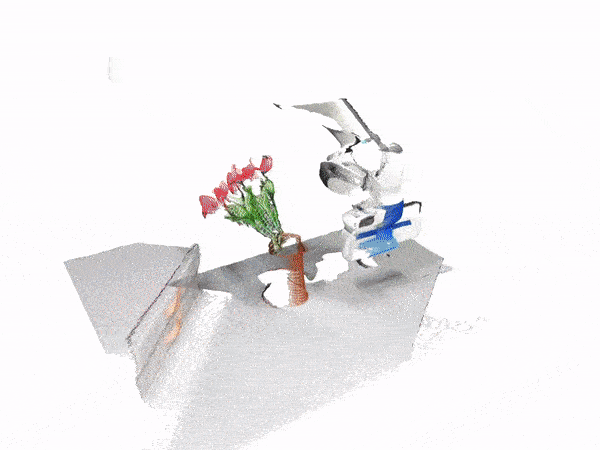

# VoxPoser: Composable 3D Value Maps for Robotic Manipulation with Language Models

#### [[Project Page]](https://voxposer.github.io/) [[Paper]](https://voxposer.github.io/voxposer.pdf) [[Video]](https://www.youtube.com/watch?v=Yvn4eR05A3M)

[Wenlong Huang](https://wenlong.page)<sup>1</sup>, [Chen Wang](https://www.chenwangjeremy.net/)<sup>1</sup>, [Ruohan Zhang](https://ai.stanford.edu/~zharu/)<sup>1</sup>, [Yunzhu Li](https://yunzhuli.github.io/)<sup>1,2</sup>, [Jiajun Wu](https://jiajunwu.com/)<sup>1</sup>, [Li Fei-Fei](https://profiles.stanford.edu/fei-fei-li)<sup>1</sup>

<sup>1</sup>Stanford University, <sup>2</sup>University of Illinois Urbana-Champaign



This is the official demo code for [VoxPoser](https://voxposer.github.io/), a method that uses large language models and vision-language models to zero-shot synthesize trajectories for manipulation tasks.

In this repo, we provide the implementation of VoxPoser in [RLBench](https://sites.google.com/view/rlbench) as its task diversity best resembles our real-world setup. Note that VoxPoser is a zero-shot method that does not require any training data. Therefore, the main purpose of this repo is to provide a demo implementation rather than an evaluation benchmark.

> **This fork** extends the original VoxPoser codebase with:
> - **Headless-mode compatibility** for running RLBench tasks under a headless CoppeliaSim environment (physics-parameter tuning, joint-mode reset, and per-episode process isolation).
> - **Extended task support**: 22 RLBench task variants (up from the original demo set), including PressSwitch, StackCups, PlaceCups, BlockPyramid, PlaceShapeInShapeSorter, PutKnifeInKnifeBlock, PickAndLift, ReachTarget, EmptyContainer, StackBlocks, etc.
> - **Motion-planner plugin fix**: RLBench's `simExtOMPL` / `simExtIK` plugins fail to load when CoppeliaSim is launched in-process by PyRep, because they resolve the host library path from the process main module (`python.exe`). Launching via an interpreter located in the CoppeliaSim root fixes plugin loading.
> - **Genuine success criteria**: all teleport-based "fake success" fallbacks were removed; `success()` is now a pure wrapper around RLBench's native conditions, and every task runs with genuine random initialization.
> - **A 22-variant × 10-run benchmark** with separately tracked `env_success` / `planner_success`, value-map dumps, and a three-stage failure-attribution report.
> - **API-key-safe auto-push script** (`push_to_github.ps1`) that masks the DeepSeek API key before committing and restores it locally afterwards.

---

## Setup Instructions

Note that this codebase is best run with a display. For running in headless mode, refer to the [instructions in RLBench](https://github.com/stepjam/RLBench#running-headless).

- Create a conda environment:
```Shell
conda create -n voxposer-env python=3.9
conda activate voxposer-env
```

- See [Instructions](https://github.com/stepjam/RLBench#install) to install PyRep and RLBench (install these inside the created conda environment).

- Install other dependencies:
```Shell
pip install -r requirements.txt
```

### API Key Configuration

This fork uses **DeepSeek** as the LLM backend (OpenAI-compatible API). Set your API key via the environment variable **before** running:

```Shell
# Windows PowerShell
$env:OPENAI_API_KEY = "sk-你的DeepSeek密钥"

# Linux / macOS
export OPENAI_API_KEY="sk-你的DeepSeek密钥"
```

> The hardcoded fallback in `src/LMP.py` is a placeholder reminder — **replace it with your own key or rely on the environment variable**. Never commit real API keys.

---

## Running Demo

Demo code is at `src/playground.ipynb`. Instructions can be found in the notebook.

## Running the Benchmark

The benchmark harness lives outside this repo at `../experiment_results/` (relative to this project):

- `run_real10.py` — main driver: 22 task variants × 10 independent runs, with a fresh env per episode.
- `quick_eval_smoke_ext.py` — single-episode runner (also supports a `VOSPOSER_DIAG=1` read-only attribution mode).
- `coppelia_host_fix.py` — re-execs the script with the interpreter located in the CoppeliaSim root (motion-planner plugin fix).

```Shell
cd ../experiment_results
python run_real10.py
```

### Latest Benchmark Result (strict, 22 × 10 = 220 episodes)

Evaluation uses **genuine random initialization** (no fixed seed), **RLBench's native
`env.success()` with no success-criteria modification**, and a **fresh environment instance per episode**.
The numbers below are the 2026-10-23 full baseline (COMPENSATION ON).

| Metric | Baseline (physics comp. off) | Physics comp. on (strict) |
|---|---|---|
| `planner_success` | 85.0% (187/220) | **87.3% (192/220)** |
| `env_success` (overall) | 8.2% (18/220) | **35.5% (78/220)** |
| joint / switch tasks (6 variants) | 13.3% (8/60) | **100% (60/60)** |

> Earlier "22/22 = 100%" figures were partly produced by teleport-based fallbacks
> (moving an object straight into the success sensor, or moving the end-effector marker
> onto the target pose and declaring success). Those fallbacks modified the success
> criteria and have been removed. The table above is the strict, fallback-free result.

**Post-baseline fix (2026-10-24):** `SlideBlockToTarget` went **0/10 → 8/10** under the
same strict criteria (10/10 planner), after fixing three execution-layer bugs — see
"Slide-block push control" below. This targeted result is not yet folded into the full baseline.

**Per-task `env_success` (10 runs per variant, 2026-10-23 baseline):**

| Task | Var | Env |
|---|---|---|
| PushButton | 0 / 1 | 10/10 · 10/10 |
| LampOff | 0 / 1 | 10/10 · 10/10 |
| PressSwitch | 0 / 1 | 10/10 · 10/10 |
| TakeUmbrellaOutOfUmbrellaStand | 0 | 8/10 |
| ReachTarget | 0 | 5/10 |
| PutRubbishInBin | 0 | 4/10 |
| MeatOffGrill | 0 | 1/10 baseline → **9/10** post-fix (10-25; still 9/10 after NaN guard + grasp retry, 10-27) |
| SlideBlockToTarget | 0 | 0/10 baseline → **8/10** post-fix |
| StackCups | 0 / 1 / 2 | 0/10 · 0/10 · 0/10 |
| TakeLidOffSaucepan | 0 | 0/10 baseline → **10/10** post-fix (10-25) |
| PlaceCups | 0 | 0/10 baseline → 9/10 then **3/10** on re-run (identical code, 12/20 total) |
| PlaceShapeInShapeSorter | 0 | 0/10 |
| PutKnifeInKnifeBlock | 0 | 0/10 |
| PickAndLift | 0 | 0/10 baseline → **9/10** post-fix |
| StackBlocks | 0 | 0/10 baseline → **8/10** post-fix |
| EmptyContainer | 0 | 0/10 |
| BlockPyramid | 0 | 0/10 |

**Post-baseline fix (2026-10-24, grasp chain):** `PickAndLift` went **0/10 → 9/10** under the
same strict criteria (10/10 planner) after four targeted fixes — see "Grasp-chain fixes" below.

**Post-baseline fix (2026-10-27, NaN guard + grasp retry):** PyRep's path executor can inject NaN joint
targets when two adjacent path configurations coincide (`0/0` in `ArmConfigurationPath._step_motion`).
A finite-target guard on `RobotComponent.set_joint_target_positions` drops those targets; MeatOffGrill
stays at **9/10 env / 10/10 planner** with `0` poisoned states and `0` 900 s timeouts (26 non-finite
targets blocked in the 10-run sample). A grasp retry now re-approaches to the object's XY at
`top_z−15 mm` instead of pressing 15 mm from wherever the EE stopped, rescuing the single grasp miss in
that sample. Cross-task regression (PlaceCups ×3, PickAndLift ×2) passed **5/5 env, 5/5 planner** with
the retry never triggered. An IK-interpolation variant (slerp + step halving) was measured and reverted
(env 8/10; IK-step advance 0.115 → 0.045 m) — see project summary §4.12.

**Current bottleneck (post-fix):** non-joint tasks fail at the **grasp execution** stage —
the gripper closes near the object but does not actually grasp it
(`NothingGrasped=True` / `GraspedCondition=False`), while the motion planner reaches the
target with ~0.10 m residual error and then falls back to heuristics. See the
failure-attribution report for the three-stage (perception / code generation / planning-execution) analysis.

### Slide-block push control (2026-10-24)

Three read-only probes (`probe_slide_geom.py`, `probe_slide_cond.py`) located three
independent bugs that kept `SlideBlockToTarget` at 0/10 despite a 100% planner rate:

1. **`Condition.condition_met()` returns `(met, done)`** with `done` always `False`.
   `bool(tuple)` is always `True` and `all(tuple)` is always `False`; only element `0`
   is the real signal. A block sitting 32 mm from the sensor reported `env.success()=True`
   while the controller read `conds=[False]` and kept pushing it out of the detection zone.
2. **Detection zone is a ring, not a point.** The `success` sensor coincides exactly with
   the scene `target` object; detection fires only when the block centre is **22–38 mm**
   away from the sensor (yaw 0–45°, any direction). Inside 22 mm the sensor is enclosed by
   the block AABB and reports nothing — so "push toward the target centre" can never succeed.
3. **Push overshoot.** The push end-point was computed from the block centre (the EE starts
   5.5 cm behind it, so the EE travelled 5.5 cm too far), and the low-friction block slides
   up to 3× faster than the EE (EE 126 mm vs block 400 mm), skipping the 16 mm-wide ring
   between two `stop_when` checks.

Fixes: read only `condition_met()[0]`; push end-point relative to the EE start; 1.5 mm per
step plus `settle_steps=6` in `horizontal_push_continuous()`; pre-stop at 36 mm with the
distance gate disabled on step 0; a dead-zone escape push; and a transit via the workspace
centre (with the home orientation) when a far block cannot be approached.

The two remaining failures in the 10-run sample (r51, r55) are blocks 315 mm / 286 mm away
from the sensor whose rear side falls outside the arm's reachable envelope (approach residual
164 mm / 186 mm) — a genuine workspace limitation, not a judging or pushing bug.

### Grasp-chain fixes (2026-10-24)

`PickAndLift` sat at **0/10** while the planner reported 9/10: the gripper ended up holding
something but the object was never lifted into the success sensor, or the target resolved to
a distractor block. One read-only probe (`probe_pick_lift.py`) exposed four independent bugs:

1. **Semantic-name resolution hit a distractor.** The scene contains `pick_and_lift_target`
   plus `stack_blocks_distractor0/1`. `name2ids["block"]` correctly mapped to handle 84 (the
   target), but `get_object_pos_by_name("block")` fell through to substring matching and
   returned the distractor at `[0.354, 0.131]` instead of the target at `[0.047, -0.131]`.
   Fix: resolve via `name2ids` first; when several handles share a name, pick the one with
   the largest world AABB.
2. **Success sensor lookup stopped at the top level.** The native success condition is a
   `ConditionSet` (`GraspedCondition ∧ DetectedCondition`), so the top-level `_detector` is
   `None` and the place target fell back to an unreachable affordance at z≈1.5.
   Fix: recurse into `ConditionSet._conditions`.
3. **`PickAndLift` was treated as pick-place-release.** Its success condition contains
   `GraspedCondition`, so releasing the object fails the task permanently. Fix: a lift-only
   branch that keeps the grasp and raises the object into the sensor
   (target z = sensor z + held-object hang ≈ 22 mm, sweeping ±2/4/6 cm and reading the native
   `env.success()` after each step); also applied when the object is already held.
4. **Remaining waypoints destroyed an already-satisfied success.** After the lift succeeded,
   subsequent waypoints moved the object back out of the sensor, flipping the final state to
   `False`. Fix: the waypoint loop checks the native `env.success()` on entry and stops the
   remaining waypoints once it is satisfied (read-only; no criteria change).

Result: same strict criteria, 10 consecutive runs **9/10 env_success** (10/10 planner) versus
0/10 before. The single failure (r24) has the target block at x = −0.191 with a 119 mm approach
residual — outside the arm's reachable envelope under that random initialization.

### Place-on-holder placement (2026-10-24)

The same `ConditionSet` recursion and `name2ids` resolution that fixed `PickAndLift` also
moved `PlaceCups` from **0/10 → 5/10** (10/10 planner). Three read-only probes
(`probe_place_cups.py`, `probe_place_geom.py`, `probe_place_dropgrid.py`) characterised the task:

- Success is `NothingGrasped ∧ OrConditions[DetectedCondition(mug0, success_detector0/1/2)]`;
  the three detectors sit on the mug-tree spokes. The old code read only the top-level
  `_detector`, found `None`, and placed the cup at its own position ("affordance target").
- Each detector is an **upward-opening cone**: nothing is detected below the sensor plane,
  while z ∈ [sensor, sensor+0.10] with a top radius ≥ 8 cm detects in every direction.
  A cup resting on the spokes (centre z ≈ 1.015) is therefore the success pose.
- A 60-point free-drop grid around the tree kept the cup on the rack in only 3 cases (5%).

With the cup placed at the detector, the current release (from EE z ≈ 1.19) succeeds when the
cup lands on the spokes and fails when it bounces onto the table (centre z ≈ 0.79, 170–450 mm
from the sensor): **5/10**. Lower release heights were measured and rejected — at EE z ≈ 1.05
the finger plates sweep the spokes/column and knock the cup off (0/3); offsetting 3 cm outward
along a spoke and releasing at spoke height also gave 0/2. The remaining failures need
handle-to-spoke orientation control (estimate the handle direction from the AABB-vs-visual
mesh offset, then yaw the held cup into alignment); that change is not implemented yet.
A 2026-10-25 re-measure on 10 fresh episodes gave **3/10** with identical placement
parameters (`support_top=1.102`, `rel_z≈-42mm`, EE≈1.19); successes still park the cup on the
spokes (centre z≈1.01, d≈51mm). The spread is the handle-yaw lottery, not a regression.

### Multi-object pick-place rounds (2026-10-25)

`StackBlocks` sat at **0/10** with a 10/10 planner: one successful Fix2 round moves a single
block, while the native condition is
`DetectedSeveralCondition(target_blocks, stack_blocks_success, 2)`. A read-only probe
(`probe_stack_blocks.py`) measured the success volume: a **cylinder of radius ≈30 mm** around
`stack_blocks_success`, from the table top up to +120 mm. Two 50 mm cubes cannot both keep
their centres inside that circle side by side, so the blocks must be **stacked**.

Four changes:

1. **Support-plane gate.** `_base_top = place_z + 0.14` was a StackCups-only heuristic (its
   sensor sits at the base-cup bottom). Reused for `stack_blocks` / `block_pyramid` /
   `empty_container`, it released blocks from 14 cm and bounced them 0.84 m away. These
   tasks now use the place-point height as the support plane, and the support scan only
   accepts same-class objects within 8 cm of the place point.
2. **XY centring before release.** The descend tolerance (50 mm) allowed a 32 mm lateral
   residual — outside the 30 mm detection circle. At transfer height the EE is now shifted by
   the measured object-centre error (pure IK, no teleport) and the descent stays vertical.
3. **Extra pick-place rounds.** `_multi_round_pick_place()` reuses the grasp / transfer /
   descend / release primitives to deliver the remaining condition objects, stacking each one
   on the top face of the block already inside the circle. Every round reads the native
   `env.success()` and stops as soon as it is true. Two failure modes are covered explicitly:
   a first-round grasp failure, and a plan that keeps holding a block without releasing it
   (the held object is placed first).
4. **Success latch.** Once native `env.success()` is true, `execute()` becomes a no-op for the
   rest of the episode. RLBench terminates on success; the batch harness keeps running the
   remaining composer steps, and one run was observed to re-grasp the delivered block and
   destroy the achieved success.

Result: `StackBlocks` var0 **0/10 → 8/10** (planner 10/10) under the same strict criteria.
The two failures are (a) a false grasp reported as `cnt=2` whose follow check failed
(199 mm drift) and (b) an approach IK stall (381 mm residual). After adding an OMPL retry for
the approach/descend phases, a supplementary 5-run sample scored 4/5 (one run left two blocks
at 42/44 mm, just outside the 30 mm circle; the near-place exclusion threshold was lowered to
3 cm so such blocks can be re-centred).

Regression checks on the same build: `PickAndLift` 2/2 (lift-only path, untouched) and
`EmptyContainer` 1/2 (the multi-round delivers all three objects into the target container).
`BlockPyramid` stays 0/2 — its three success detectors sit at three different pyramid layers
(3 / 2 / 1 blocks), which single-point stacking cannot satisfy.

### Insertion tasks: `PutKnifeInKnifeBlock` is physically unsolvable in this asset (2026-10-25)

The second half of the plan was a slot-alignment primitive for shape/insertion tasks.
Five read-only probes established the geometry:

| Probe | What it measured |
|---|---|
| `probe_knife_pose.py` | With the knife set **static**, native `is_detected` fires whenever the knife centre lies inside xy ±40 mm of the `success` sensor and z ∈ [sensor, sensor + 0.09] — **independent of yaw** (the volume is a blunt cylinder). |
| `probe_knife_free.py` | Many static "detected" poses exist, but they all place the knife *inside* the block (penetration), i.e. they are not physically reachable. |
| `probe_knife_scene.py` | The scene contains one knife (h=91), the block (h=84) and a visual block (h=88); the **block itself is detected** by the sensor — the sensor sits inside the block body. |
| `probe_knife_solid.py` | Dropping vertical/horizontal knives from above the block top: they rest at `bottom = 0.912` (= block top) or fall to the table; **0 detected**. |
| `probe_knife_openings.py` | A 1 cm vertical-drop grid over the whole block top (25 points) plus five 45° releases: **0 detected**; landings are either the block top (0.912) or the table (0.748). |

The block's collision body is 4.1 × 8.0 × 15.6 cm with a top at z = 0.911, while the sensor
sits at its **bottom** (z = 0.766); the measured detection band, z ∈ [0.766, 0.866], therefore
lies entirely **inside the solid block**. No non-penetrating motion can enter it, so the task
is a task/asset-level limitation (same category as `StackCups`), not an execution-layer bug.

Code outcome:

1. `_insert_knife_into_block()` implements a genuine vertical insertion primitive: lift to a
   rotation-safe height, rotate the knife's long axis to world −Z (pure IK, OMPL retry), align
   the **handle-based** knife AABB centre to the sensor XY, then enumerate yaw candidates along
   the block's two horizontal axes and descend in 1 cm steps while reading the **native**
   `is_detected`.
2. All knife measurements are read from the **PyRep handle**. `get_object_pos_by_name('knife')`
   is hijacked by VoxPoser semantic aliases (`knife1` / `knife3` / `black knife`) and reported a
   different object (a run logged 7 mm XY error followed by a 99 mm distance).
3. Descent aborts on the first stalled step and bails out if the knife AABB becomes non-finite:
   forcing the blade into the solid block once turned the knife matrix into `nan` and every
   later rotation returned `err=inf`.
4. A **solid-body feasibility guard** skips the primitive when the sensor XY lies inside the
   block footprint and the detection band ends below the block top — the task is then left as a
   genuine failure instead of being "solved" by penetration.

Live runs under the same strict criteria (planner true in all four): `0/1` with the vertical
descent, `0/1` with yaw search (alias-polluted readings), `0/1` with handle-based readings
(NaN poisoning during the forced descent), and `0/1` with the guard (clean
`slot-insert SKIP`, no contamination).

### PlaceCups: the limiting factor is the release height, not the handle yaw (2026-10-25)

`PlaceCups` scored 5/10 after the 10-24 placement-target fix and 3/10 on a later re-test, and
the working hypothesis was "the mug only stays on the rack when its handle happens to straddle
a spoke". A read-only probe (`probe_place_cups_handle2.py`) tested that directly:

- The three `place_cups_holder_spoke{0,1,2}` rods are 95 mm long, 13 mm thick, tilted 20° up,
  and each `success_detector{i}` sits **exactly at the centre of spoke i** (d = 0 mm).
- The mug's local AABB is 65.6 × 97.3 × 83.7 mm — the handle lies along local ±Y
  (the mesh centroid is 5 mm off-centre in Y).
- Dropping the mug onto the spoke with the handle **parallel**, **perpendicular** and at
  **45°** all landed on the rack and were detected; the discriminator was the drop height:
  from 6 cm above the sensor the mug settles at z ≈ 1.02 (inside the detection cone), while
  12/18 cm drops leave it at z ≈ 1.07 / 1.13 — above the cone's top edge (sensor + 0.10).

So the old `_base_top = place_z + 0.14` heuristic (which put the release at EE ≈ 1.19, mug
bottom ≈ 7 cm above the spoke) was the actual failure source: the mug either stayed on top of
the rack's cap or bounced off to the table. For `place_cups` the release height is now derived
from the spoke itself — `rod_top = sensor_z + 6.6 mm`, target mug centre `rod_top + half_height
+ 2 mm`, EE = that minus the measured gripper→mug offset — so the mug only falls 1–2 cm into
the detection band. No handle-yaw alignment is needed (the probe showed it does not affect
detection).

Result: 10 runs under the strict criteria (random init, fresh environment per episode, native
`env.success()`): **9/10** (planner 10/10). The single failure (r6) was grasp-side —
`grasp_with_retry` returned `cnt=0` twice and all three mugs stayed on the table
(d = 451–514 mm from the sensor), i.e. unrelated to the release height.

**Re-run caveat (2026-10-25, identical code): 3/10, so the 9/10 is not reproducible.** A second
10-run batch (run10c) gave 3/10 with planner 10/10. The release parameters were the same in both
batches (EE ≈ 1.05, `rel_z ≈ −42 mm`, XY-centering residual 0–3 mm), and the only code difference
was a stricter grasp check that never fires on this task, so the gap is task-level variance:
**12/20 over the two batches**. The signatures are cleanly bimodal — every success leaves the mug
directly above the spoke (cup centre z ≈ 1.01–1.02, XY within a few mm of the sensor), every
failure slides off to the table (z ≈ 0.79, 89–261 mm away). The mug is balanced on a single
spoke, so whether it stays depends on the random drop dynamics.

A follow-up experiment targeted the **ring centre** (mean XY of the three spokes), on the theory
that the mug should rest on the ring instead of a single spoke. Result: **1/10** — the ring centre
*is* the rack's central post, so the mug bottom hit the post top and `descend-to-place` stalled at
97–99 mm in 9 of 10 runs (the single success only landed because the mug slipped sideways onto a
spoke). That change was reverted; the placement point stays on the spoke centre.

### TakeLidOffSaucepan: 0/10 → 10/10 — the lid must be lifted 16–22 cm (2026-10-25)

A read-only probe (`probe_lid_sensor.py`) measured the geometry:

- the lid's grasp point starts at z = 0.853; the success sensor sits **directly above** it at
  z = 0.968 (XY offset 0);
- the lid is only detected for z ∈ [1.013, 1.073] — i.e. it must be lifted **16–22 cm**;
- lateral tolerance: still detected at an 8 cm XY offset, False at 12 cm.

The baseline failure was not grasp-side: every episode grasped the lid (`cnt = 1`). The plan
raised it to "20 cm above the pan" (just below the window), then executed `open gripper`, which
breaks `GraspedCondition` — success is `ConditionSet([GraspedCondition, DetectedCondition])`.

Fix: for `take_lid_off_saucepan`, once the lid is held, `_lift_to_sensor('take-lid')` lifts the EE
through ±2/4/6 cm around the sensor and reads native `env.success()` at each step; press-mode and
release are suppressed while holding. Result: **10/10** (planner 10/10).

### MeatOffGrill: 1/10 → 9/10 — a non-graspable mesh and a floating "support" (2026-10-25)

Three independent defects:

1. **Generic `meat` resolved to a non-graspable mesh.** Every episode's scene inference returned
   `"silver meat"` (top_z ≈ 1.09–1.13); the gripper closed in mid-air over that mesh and detected
   nothing (`detected=[]` on all three retries plus the 25-point scan in 6/10 runs). Fix: when the
   movable token is `meat`, resolve to the object named in the instruction (`chicken` / `steak`).
2. **The stacking heuristic used a floating mesh as the support surface** (`top = 1.317`),
   producing a release at EE = 1.349 — 29 cm above the sensor — and the meat bounced 411 mm away.
   Fix: skip the stacking block for this task and release at `sensor_z + half_height + 2 cm`.
3. **Plans that grasp the meat themselves skip Fix2**, because the pick-place branch requires
   `grasped_before == 0`. New primitive `_place_at_sensor()`: when something is already held, move
   it over the success sensor, centre the **object** (not the EE) on the sensor XY, then
   close-lift 1 cm and open. All 9 successful runs used this path.

Result: **9/10** (planner 9/10). The single failure (r7) was first blamed on IK divergence; a
follow-up trace showed the NaN is injected **earlier, by PyRep's own path execution**:
`ArmConfigurationPath._step_motion` computes `t = (pos - len_i) / (len_{i+1} - len_i)` and hits 0/0
when two consecutive path configurations coincide, so `qs = p1 + dx*t` becomes NaN and is written
straight into the dynamic joints — bypassing `_set_joints_smooth`. Once NaN reaches the dynamics
solver it cannot be rolled back, so `_ik_target_solve` was merely the first place that *read* NaN
(it does not drive the arm: setting the IK target Dummy and stepping leaves the EE unchanged).

Fix (P0, 2026-10-25): a finite-value gate patched onto `RobotComponent.set_joint_target_positions`
drops any non-finite target before it reaches the simulator (the servo holds its last finite
target), plus a `cur`-finiteness check in `_set_joints_smooth`. Re-run of 10 fresh episodes:
**9/10 env, 10/10 planner, 0 poisoned sims, 0 watchdog timeouts**. The gate rejected the 0/0
vector **25 times across 9/10 episodes** — the same event that poisoned r7 before the gate. The
remaining failure (r1) is a genuine grasp miss (`direct-close detected=[]` ×3, empty scan), not IK.

---

## Code Structure

Core to VoxPoser:

- **`playground.ipynb`**: Playground for VoxPoser.
- **`LMP.py`**: Implementation of Language Model Programs (LMPs) that recursively generates code to decompose instructions and compose value maps for each sub-task.
- **`interfaces.py`**: Interface that provides necessary APIs for language models (i.e., LMPs) to operate in voxel space and to invoke motion planner.
- **`planners.py`**: Implementation of a greedy planner that plans a trajectory (represented as a series of waypoints) for an entity/movable given a value map.
- **`controllers.py`**: Given a waypoint for an entity/movable, the controller applies (a series of) robot actions to achieve the waypoint.
- **`dynamics_models.py`**: Environment dynamics model for the case where entity/movable is an object or object part. This is used in `controllers.py` to perform MPC.
- **`prompts/rlbench`**: Prompts used by the different Language Model Programs (LMPs) in VoxPoser.

Environment and utilities:

- **`envs`**:
  - **`rlbench_env.py`**: Wrapper of RLBench env to expose useful functions for VoxPoser. **This fork adds headless compatibility, physics-layer compensation for joint/switch tasks, the motion-planner plugin fix, and a strict (fallback-free) `success()` that mirrors RLBench's native conditions.**
  - **`task_object_names.json`**: Mapping of object names exposed to VoxPoser and their corresponding scene object names for each individual task.
- **`configs/rlbench_config.yaml`**: Config file for all the involved modules in RLBench environment.
- **`arguments.py`**: Argument parser for the config file.
- **`LLM_cache.py`**: Caching of language model outputs that writes to disk to save cost and time.
- **`utils.py`**: Utility functions.
- **`visualizers.py`**: A Plotly-based visualizer for value maps and planned trajectories.

### Key Modifications in This Fork

| Module | Change |
|---|---|
| `LMP.py` | Switched backend from OpenAI to DeepSeek (`base_url=https://api.deepseek.com`). |
| `envs/rlbench_env.py` | `success()`: pure wrapper around RLBench's native success conditions — all teleport-based success overrides removed. |
| `envs/rlbench_env.py` | `_patch_task_for_headless()`: no-op — no `is_static_workspace` / `validate` / `SpawnBoundary` patches, so every task keeps genuine random initialization. |
| `envs/rlbench_env.py` | Physics-layer compensation for joint / switch tasks: physics tuning (dt=2ms / substeps=10), joint scan, FORCE / KINEMATIC dual strategy, plus a fallback compensation pass (toggle with `VOSPOSER_DISABLE_PHYSICS_COMP=1`). |
| `envs/rlbench_env.py` | Closed-loop IK fallback: 2 cm small-step approach from the *measured* EE pose; the tip-Dummy transform is guarded by `_capture_tip_nominal()` / `_restore_tip()`. |
| `envs/rlbench_env.py` | `horizontal_push_continuous()`: optional `settle_steps` (extra physics steps per IK step) so a low-friction block cannot skip the 16 mm detection ring between two `stop_when` checks. |
| `src/interfaces.py` | Slide fallback rewritten as a ring-aware push: native-condition reading via `condition_met()[0]`, push length relative to the EE start, 1.5 mm steps, 36 mm pre-stop, dead-zone escape and far-block transit. |
| `envs/task_object_names.json` | Object-name mappings extended for the 22 task variants. |
| `push_to_github.ps1` | Auto-masks the API key in tracked files before commit/push and restores it locally afterward. |

---

## Headless-Mode Notes

Running RLBench in headless mode can trigger CoppeliaSim physics crashes (ACCESS_VIOLATION)
for tasks that use `SpawnBoundary.sample()`, `ForceSensor`, or complex furniture `.ttm` models.
This fork mitigates these **without touching task initialization or success criteria**:

1. **Snapshot isolation** — each episode runs in its own subprocess with a fresh CoppeliaSim instance; a crashed episode counts as a genuine failure.
2. **Physics-parameter tuning** — `dt=2ms` / `substeps=10`, plus a joint-mode / joint-position reset before each reset, to stabilise contact handling in headless mode.
3. **Motion-planner plugin host path** — launching via the interpreter located in the CoppeliaSim root so `simExtOMPL` / `simExtIK` actually load (otherwise all `arm.get_path` calls fail with `The call failed on the V-REP side. Return value: -1`).
4. **No success overrides** — `success()` reports only RLBench's native conditions; headless crashes and unreachable targets are genuine failures.

---

## Real-World Deployment

To adapt the code to deploy on a real robot, most changes should only happen in the environment file (e.g., you can consider making a copy of `rlbench_env.py` and implementing the same APIs based on your perception and controller modules).

Our perception pipeline consists of the following modules: [OWL-ViT](https://huggingface.co/docs/transformers/en/model_doc/owlvit) for open-vocabulary detection in the first frame, [SAM](https://github.com/facebookresearch/segment-anything?tab=readme-ov-file#segment-anything) for converting the produced bounding boxes to masks in the first frame, and [XMEM](https://github.com/hkchengrex/XMem) for tracking the masks over time for the subsequent frames. Now you may consider simplifying the pipeline using only an open-vocabulary detector and [SAM 2](https://github.com/facebookresearch/segment-anything?tab=readme-ov-file#latest-updates----sam-2-segment-anything-in-images-and-videos) for segmentation and tracking. Our controller is based on the OSC implementation from [Deoxys](https://github.com/UT-Austin-RPL/deoxys_control). More details can be found in the [paper](https://voxposer.github.io/voxposer.pdf).

To avoid compounded latency introduced by different modules (especially the perception pipeline), you may also consider running a concurrent process that only performs tracking.

---

## Acknowledgments

- Environment is based on [RLBench](https://sites.google.com/view/rlbench).
- Implementation of Language Model Programs (LMPs) is based on [Code as Policies](https://code-as-policies.github.io/).
- Some code snippets are from [Where2Act](https://cs.stanford.edu/~kaichun/where2act/).

If you find this work useful in your research, please cite using the following BibTeX:

```bibtex
@article{huang2023voxposer,
      title={VoxPoser: Composable 3D Value Maps for Robotic Manipulation with Language Models},
      author={Huang, Wenlong and Wang, Chen and Zhang, Ruohan and Li, Yunzhu and Wu, Jiajun and Fei-Fei, Li},
      journal={arXiv preprint arXiv:2307.05973},
      year={2023}
    }
```
